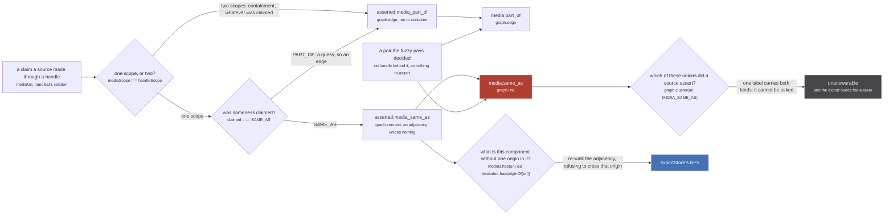
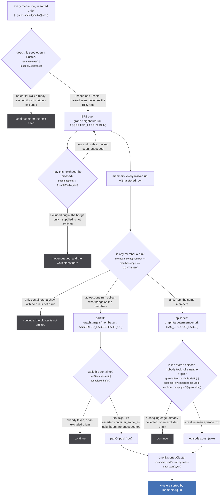

`exportStore` (`src/worker/store/export.ts:24`) is the fifth read, and it shares no code with the
other four. It never calls `graph.cluster`, never touches `media:same_as`, never aggregates anything,
and hands back the stored `Media` and `Episode` rows themselves rather than a computed `GQLMedia`.
It walks a second, redundant adjacency that `upsertMedia` maintains alongside the identity spaces,
and reconstructs the clusters from that.

That sounds like a worse version of the read the rest of the site describes. It is a different
question. Every other read asks "what does the store believe about this uri". This one asks "what did
a **source** claim, and what would the answer be with one origin taken out", and a union-find can
answer neither:

`src/worker/store/db.ts:56-64`

> A second, adjacency-only record of every pair a SOURCE claimed through a handle, written by
> `upsertMedia` and by nothing else. `./export.ts` is its only reader.
>
> Two properties the identity labels above cannot supply, and the export needs both. `graph.link`
> carries the same label whether the pair came from a handle or from `linkSameMediaPairs`, so a
> cluster cannot say which of its unions a source actually asserted; and a union-find cannot answer
> "what would this component be with that node removed", which is exactly what excluding a plugin or
> the offline origin asks. An adjacency answers both, and unions nothing, so nothing downstream of
> the store sees these labels at all.

Its one caller today is the season walk, `scripts/walk-season-answers.mjs`, which enumerates a
season's runs through it before recording their answers.

## Why a shadow record exists

Every claim `upsertMedia` applies is written twice: once into the identity space, which is what the
page reads, and once into `ASSERTED_LABELS` (`db.ts:66-70`), which only the export reads. The routing
is the same 2x2 both times, at `db.ts:187-197`.



*The left half is one claim writing two records. The right half is the only question each record can answer, and they are different questions.*

The figure names the run-space labels. A claim between two CONTAINER rows takes the identical route
into `asserted:container_same_as` and `container:same_as` instead, chosen on the same line that
picks the identity space (`db.ts:192-193`).

Three consequences fall straight out of that figure.

**A fuzzy union is invisible to the export.** `linkSameMediaPairs` (`db.ts:216-224`),
`linkSameContainerPairs` (`db.ts:231-239`) and `linkPartOfPairs` (`db.ts:247-255`) write the identity
labels only. No handle backed those pairs, so there is nothing to assert. The test states it as a
control and its opposite in one place, `tests/unit/worker/store/export.test.ts:56-61`: after
`linkSameMediaPairs([['anilist:1', 'kitsu:2']])`, `findAggregatedMedia('anilist:1')` answers a
two-member cluster and `exportStore` answers `[['anilist:1'], ['kitsu:2']]`.

**The asserted write's return value is thrown away**, deliberately:

`src/worker/store/db.ts:173-176`

> Each applied claim is also recorded in ASSERTED_LABELS, and those writes' return values are
> DISCARDED: `changed` stays driven by the real labels alone. Feeding it an asserted write would put
> every listener back in the re-read loop tests/unit/worker/store/edge-idempotence.test.ts exists to
> stop, since the two records can go new at different times.

**Episodes have no asserted record at all.** `upsertEpisodes` (`db.ts:400-415`) writes
`episode:same_as`, `episode:part_of` and `has_episode` and nothing else, so an episode reaches the
export only along the `HAS_EPISODE` edge from a member that was already walked, never through an
episode union. That is the one label the export reads that was not written as an assertion, and it is
safe because the edge records which media a source hung the episode off, never that two episodes are
the same thing.

## The walk

`exportStore` takes `{ excludeOrigins }` and returns `{ exportedAt, excludedOrigins, clusters }`.
One predicate decides everything, at `export.ts:28`:

```ts
const usableMedia = (uri: string) => medias.has(uri) && !excluded.has(originOf(uri))
```



*Five refusals, none of them fatal: a seed is skipped, a cluster is dropped, a row is left out. Nothing here throws and nothing here writes.*

Reading it against the file:

| step | line | note |
| --- | --- | --- |
| seeds, sorted | `export.ts:33` | `[...medias].sort()` over the `'media'` label index, so seed order is lexicographic and does not depend on arrival order |
| the seed gate | `:34-35` | each media row belongs to at most one cluster: `seen` is added to at seed time and at enqueue time |
| the run BFS | `:39-48` | `graph.neighbours` reads the undirected adjacency `graph.connect` wrote (`graph.ts:265-277`) |
| the run refusal | `:49` | the only place a whole cluster is discarded |
| the container BFS | `:51-65` | nested inside the member loop, seeded from each asserted `PART_OF` target |
| the episode walk | `:67-76` | one skip, `:71` |
| sorting | `:79-81`, `:88` | members, partOf, episodes by uri, then clusters by their first member |

One subtlety in the refusal at `:49`. It tests each member's scope rather than assuming the run
adjacency only holds runs, because a row in it can have become a container since:
`asserted:media_same_as` is written only when both ends read RUN at claim time (`db.ts:192`), and
scope is a ratchet toward CONTAINER afterwards (`db.ts:142-146`). The scope is read at export time, so
a cluster whose members all flipped is dropped even though every pair in it was asserted between two
runs.

Two smaller facts, both on the figure. The container BFS pushes neighbours
without a `partSeen` test at push time (`:62`) and tests at shift instead (`:58`), so the queue can
carry duplicates and still terminates. And a same-scope `PART_OF` claim writes
`asserted:media_part_of` between two RUN rows (`db.ts:195`), so `partOf` is not guaranteed to hold
only containers; it holds whatever a source pointed at without claiming to be.

## Refusing an origin

`excludeOrigins` is for an origin whose word is not trusted, a plugin. Its rows are left out and the
walk never crosses them, so a bridge only that origin supplied splits rather than surviving. The test
builds exactly that, `tests/unit/worker/store/export.test.ts:63-69`: a plugin row `p:1` whose handles
name `anilist:1` and `mal:2` exports one cluster of three with nothing excluded, and
`[['anilist:1'], ['mal:2']]` with `p` excluded.

:::caution
**A plugin is always excluded, and the caller does not get to choose.** `exportStore` itself refuses
nothing beyond its list (`export.ts:21-22`: "a caller that excludes no origin gets the plugin rows
too"). The exclusion is applied one layer up, in the osra resolver:

`src/worker/yoga.ts:71-72`

> the plugin origins are derived HERE rather than taken from the caller, so a caller cannot decline
> to exclude them: a plugin's rows are that user's, never the product's.

`yoga.ts:75-78` concatenates every `extractors` entry that carries a `pluginUri` onto whatever the
caller passed, so a plugin origin is always in `excludeOrigins` and is therefore never crossed. Its
rows stay in that user's store and its bridges never become anybody else's identity.
:::

## What the walk is for

The export has exactly one door into it, and the door is a flag:

`src/store-export.ts:1-6`

> The store export reaches a page ONLY through `?export=store`, and only as a window function: the
> schema has no field that answers "every cluster in the store" (`Subscription.mediaPage` fuzzy
> merges, hides attached containers, filters and sorts before a caller sees anything), and a query
> field would be permanent product surface plus a second copy of the store in graphcache. A flagged
> window function exists only on a page that asked for it, and its ABSENCE is what tells the exporter
> the flag never reached the app, which otherwise looks exactly like a store holding nothing.

`readExportFlag` (`src/utils/export-flag.ts:13-18`) matches exactly `?export=store`, never mere
presence of the parameter, and never throws. The consumer is `scripts/walk-season-answers.mjs`, which
opens the listing with `?export=store` and reads the hook at `:317`. Its absence is a hard failure
rather than an empty export, at `:311`:

> CONTROL FAILED: window.__stubExportStore never appeared on the listing, so the flag never reached
> the app and the season could not be enumerated.

## Determinism, and the one field that is not

The contract promises repeatability:

`src/worker/store/export.ts:13-19`

> Every run-space cluster the store holds, built from ASSERTED sameness only.
>
> Promises: it reads, and never writes. It walks only pairs a source claimed through a handle
> (`ASSERTED_LABELS` in ./db.ts), never a union the fuzzy pass made. It refuses to walk THROUGH an
> excluded origin, so a bridge only an excluded source supplied splits rather than surviving. It
> emits nothing whose members are all CONTAINER: a show with no run is not a run. Output is sorted
> throughout, so two calls against one store are byte-identical.

Every part of that holds for `clusters`, and it is worth naming what makes it hold: seeds are sorted
(`:33`), each of the three lists inside a cluster is sorted by uri (`:79-81`), and the clusters
themselves are sorted by their first member (`:88`). Nothing in the walk consults arrival order, and
nothing in it writes, which makes it the only read on this site that is neither a view of a union nor
a write in disguise.

**Read the envelope literally, though, because `exportedAt` is `new Date().toISOString()`
(`export.ts:86`).** Two calls against one store are byte-identical in `clusters` and differ in that
one field, so a diff of whole payloads always reports a change. The season walk already treats it that
way: its settle signature (`scripts/walk-season-answers.mjs:323`) is built from `snapshot.clusters`
alone and never reads the envelope.

## Where to go next

- the primitives this walk reads, and why `connect` exists next to `link`:
  [the graph](/write/graph/)
- the writer that keeps the adjacency, claim by claim: [upsertMedia](/write/upsert-media/)
- the four reads that do the opposite of this one, unions and all:
  [the five reads](/read/entry-points/)
- the pass whose unions this walk refuses to see: [the fuzzy merge](/merge/fuzzy-merge/)
- why a plugin origin is refused rather than trusted: [plugin sources](/request/plugins/)
